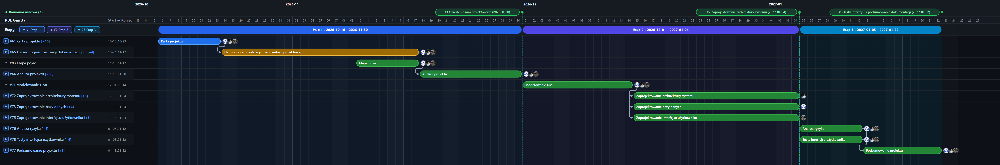

# GitHub Projects v2 Gantt Chart Generator

A zero-dependency Python tool (using only the Python standard library) that exports **GitHub Projects v2** data and generates an interactive **Gantt Chart (`HTML` + `SVG` + `PNG`)**.



## Features
- **Full GitHub Projects v2 Export (GraphQL + REST API):**
  - Issues, Sub-issues, Parent issues, and multi-level WBS hierarchy,
  - Native `Blocked by` / `Blocking` dependency relationships rendered as rounded orthogonal arrows,
  - Milestones (`◆`), assignees (with GitHub avatars), and custom fields (`Status`, `Start date`, `Target date`).
- **Interactive Gantt Chart (`HTML` + `SVG` + `PNG`):**
  - Top Stage Band and Milestone Band (`◆`),
  - Collapsible/expandable WBS task tree (`▼/▶`),
  - Task pill colors mapped to GitHub Project statuses (`Backlog`, `In progress`, `In review`, `Done`),
  - Dark mode (default) and Light mode toggle,
  - Built-in export to `PNG` (2x Retina), `SVG`, and `CSV`.

---

## Requirements
- **Python 3.10+** (no third-party `pip` packages required),
- A GitHub Personal Access Token with `repo` and `read:project` scopes (passed via the `GITHUB_TOKEN` environment variable, `--token` flag, or an active `gh auth login` session).

---

## Quick Start

1. **Export data from a GitHub Project and generate the chart:**
   ```bash
   python export_github_project.py --url "https://github.com/users/<OWNER>/projects/<NUMBER>"
   ```
   This single command generates:
   - `project_export.json` — full hierarchy, dates, and dependency relationships,
   - `project_export.csv` — flattened table ready for Excel / Google Sheets,
   - `gantt_chart.html` — interactive Gantt chart to open in any browser,
   - `gantt_chart.png` — high-resolution (2x Retina) static image of the chart.

2. **Regenerate the chart (`gantt_chart.html` + `gantt_chart.png`) from an existing `project_export.json`:**
   ```bash
   python generate_gantt.py
   ```

---

## Usage as a Git Submodule with GitHub Actions

You can include this repository as a submodule in your main project repository:
```bash
git submodule add https://github.com/<OWNER>/<GANTT-REPO>.git wykres_gantta
```

Then in your **GitHub Actions** workflow:
```bash
python wykres_gantta/export_github_project.py --url "$GH_PROJECT_URL" --output-prefix "_site/project_export"
python wykres_gantta/generate_gantt.py "_site/project_export.json" "_site/index.html" "_site/gantt_chart.png"
```
